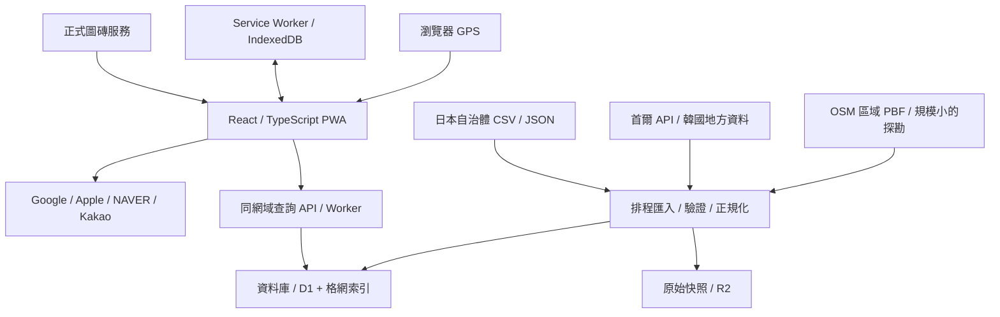

# 日韓公廁地圖 PWA：系統與產品設計

版本：規劃草案 v0.1；2026-10-11。API 依據與實測限制見 [API_DISCOVERY.md](API_DISCOVERY.md)。

## 1. 建議方向

做一個手機優先、免登入即可找廁所的 PWA。使用者開啟後可定位、看附近公廁、判斷使用條件，再轉到地圖 App 或網頁。繁體中文為初始介面，保留日／韓文名稱與地址；預留英文、日文、韓文介面。

地理範圍以日本與韓國為目標。第一階段優先驗證東京已串接區域與首爾，其他地區逐步接入官方來源與 OSM 區域資料。頁面明示目前資料涵蓋的區域；不把只驗證過江東區的結果宣稱為整個東京，更不承諾日韓所有公廁均已收錄。

推薦架構是 React + TypeScript + MapLibre + 後端匯入／查詢 API。採有正式服務條款的圖磚供應商，先評估 MapTiler；保留替換底圖能力。公廁資料的更新與使用者 GPS 更新是兩條獨立流程。

## 2. 「可以使用」的定義

公開資料與地圖 POI 不會自動提供現場空位、清潔中、故障或臨時上鎖狀態。介面應表達判斷依據：

| 維度 | 狀態 | 呈現 |
| --- | --- | --- |
| 開放時間 | schedule_open / schedule_closed / unknown | 「依開放時間推估開放」／「目前非開放時段」／「時間未提供」 |
| 使用資格 | public / public_by_agreement / customers / permit / private / unknown | 「公共設施」／「民間開放」／「限顧客」等 |
| 現場回報 | recently_usable / reported_closed / disputed / none | 「有人於 20 分鐘前確認可用」；顯示回報時間 |
| 設備 | yes / no / limited / unknown | 無障礙、尿布台等；未知不當成沒有 |

第一版主要提供開放時間推估與使用條件，近期回報在第二階段導入。即使時間推估開放，也不標成「即時保證可用」。來源缺開放時間仍可顯示，但須明確標記。`private`／`access=no` 不進入公共廁所推薦；限顧客與許可制以明確標籤、預設關閉的篩選提供。

「現在開放」篩選只納入可解析時段且當下為開放的記錄，未知不混入。可以另選「包含時間未知」，避免資料不足時出現誤導性的零結果。資料集提供者、坐標精度、時間完整度、近期回報各自顯示，不用單一來源名稱推論全部可信。

## 3. 主使用流程與介面

```text
開啟 PWA → 顯示地圖／上次瀏覽區域 → 點「定位」並授權
           ↓                         ↓ 拒絕／逾時
    定位點＋精度圈＋附近清單          城市／車站選擇或移動地圖
           ↓
    點地圖標記或清單 → 詳細卡 → 選導航服務 → App／網頁
```

不在初次載入立刻彈出定位請求；讓使用者先看到用途。位置仍未取得時顯示「距離以地圖中心計算」，取得位置後才使用「距離你」。身處日韓以外時仍可選城市規劃行程。

手機草圖：

```text
┌──────────────────────────┐
│ 找廁所   [城市／車站] [⋯] │
│ [現在開放] [無障礙] [免費]│
│                          │
│   地圖＋群聚標記          │
│   目前位置與精度圈        │
│                 [定位 ◎] │
│ [搜尋這個區域]            │
├──────────────────────────┤
│ 附近 12 間 · 資料更新時間  │
│ ○ 公廁名稱   直線距離320m │
│   時間推估開放 · 無障礙    │
│   [查看詳情]    [導航 ↗]  │
└──────────────────────────┘
```

詳細卡：名稱、當地原文、直線距離、入口／樓層、公共或民間開放、時間與原文、免費／付費／未知、無障礙／尿布台／男女與共用設施、來源與更新時間、導航、複製地址。資料不足時保留空值並顯示「未提供」。付款或設備未知不可標成免費或有設備。

城市／車站搜尋先採可署名的區域地名清單、原名與中文別名，在本地索引搜尋；保留資料来源與版本。第一版不依賴每次輸入都呼叫付費地址搜尋。全地址搜尋另選有明確授權與配額的 geocoding provider。

視覺採淺色底圖、深藍操作色；綠色表示時段推估開放，灰色表示未知，棕橙色表示限制與關閉。圖示與文字同時表示狀態。44px 以上點擊區、底部安全區、可鍵盤操作的清單、畫面閱讀器描述。選單不遮住底圖 attribution。

使用者手動平移後暫停跟隨，顯示「搜尋這個區域」；定位更新不強制把地圖拉回。低倍率先顯示群聚，放大後顯示單點。WebGL 不可用時仍能使用附近清單與導航。

## 4. 定位與 PWA 能力

使用瀏覽器 Geolocation API，不需要付費定位 API。必須 HTTPS 並取得使用者授權。

- 先 `getCurrentPosition`；設定可接受的快取與約 10 秒 timeout，先取得可用位置。
- 使用者開啟跟隨時才 `watchPosition`；需要時開啟高精度，背景／關閉跟隨時 `clearWatch`。
- GPS 可持續更新位置點；附近資料請求依移動超過約 100–200m、跨資料格網或使用者搜尋才觸發，且合併短時間重複請求。數值是待實測的預設。
- 保留 `accuracy`、讀值時間；低精度時顯示圈與提示，不用抖動位置重排清單。
- 回前景重新取樣；PWA 不保證背景持續 GPS、鎖屏追蹤或等間隔更新。
- 權限拒絕、timeout、裝置無法定位均提供手動搜尋；不自行以 IP 推測精確位置。

PWA manifest 包含 name、start_url、scope、standalone、192／512 圖示及 maskable 圖示；Service Worker 管理應用殼；IndexedDB 管理瀏覽過的廁所資料與使用者偏好。

| 內容 | 第一版快取設計 |
| --- | --- |
| JS／CSS／圖示 | 版本化 precache；升版提示重新載入 |
| 瀏覽過的公廁資料 | network-first，離線回既有資料；顯示下載時間與過期狀態 |
| 開放狀態 | 快取原始時段；以當地時間重算，不持續沿用舊 `open_now` |
| 地圖圖磚 | 依供應商 HTTP 與合約規則；第一版不預抓城市／國家圖磚 |
| 導航 | 產生連結；外部 App／網站自行處理網路與離線能力 |

離線時仍能開啟應用殼、查看已快取清單與複製地址；底圖未必可用，顯示清單 fallback。下載完整離線地圖列為後續功能，需另選允許離線的圖磚方案。

安裝提示依能力處理：Android／支援瀏覽器可顯示安裝操作，iOS 提供加入主畫面的步驟；不承諾所有瀏覽器均有程式觸發的安裝彈窗。

## 5. 系統架構



MVP 後端可用 Cloudflare Worker + D1 + R2。Worker 只負責 HTTP 查詢與小型同步工作；國家級 PBF 的篩選、解析與大型匯入在 CI／獨立 Python 任務執行，產出小型標準檔，再透過匯入 API 或受控資料庫操作更新。不能在 128MB Worker isolate 內處理數百 MB／GB 的原始 PBF。

D1 用格網／geohash 與 latitude／longitude 索引取候選，不假設有 PostGIS 空間函數。鄰近查詢必須涵蓋相鄰格網，再做 bbox／Haversine 精確篩選。查詢跨城市或候選過多時回群聚／分頁，不截斷後宣稱完整。後續有道路距離排序、複雜空間 joins 或實測查詢瓶頸，再遷移 PostgreSQL + PostGIS。

前端可靜態部署；若選 Sites 託管，依 Sites 當時支持的 Worker／D1／R2 工作流包裝。架構與 API 合約不依賴特定 hosting，部署及帳號設定留到實作階段。

## 6. 匯入、品質與更新

來源 registry 保存國家／地區、下載入口、schema 版本、授權、attribution、查詢限制、更新週期與 TLS 支援。

1. 下載並保存原始快照、來源日期、抓取時間與 hash。支援條件式抓取及限流。
2. 偵測 UTF-8／BOM／CP932 等編碼、CSV／JSON 欄位差異；未知 schema 進隔離區。
3. 轉成 WGS84；保留原 CRS、`coordinate_source`、精度類別。Seoul `COORD_X` 是 longitude，`COORD_Y` 是 latitude；正式匯入仍核對 CRS。
4. 驗證數值、0／0、經緯顛倒、國家與行政區合理性、空地址、來源 ID 重複。無座標資料待補，不畫假座標。
5. 正規化使用資格、三／四值設備、時間；無法解析則 unknown 並保留原文。
6. 先按來源與 ID upsert。跨來源去重只產生候選：距離、名稱、地址、入口／樓層綜合判斷；距離近不代表同一廁所。
7. 候選 merge 保留各欄位出處及衝突。入口附近的男女分棟或樓層不同，不自動誤合併。
8. 在 staging 驗證筆數、座標與欄位缺失變化，再原子切換資料版本；失敗保留上一成功版。

暫定每天檢查官方更新，依來源更新頻率調整；OSM 正式採區域匯出／差分定期處理，不把公開 Overpass 當每位訪客的查詢後端。單次來源缺資料不直接刪除；連續快照缺席先標待確認，並保留歷史與 tombstone。

時間處理：日本 `Asia/Tokyo`，韓國 `Asia/Seoul`；跨午夜時段用區域當地時間；韓國 `25:00` 代表隔日 01:00 的情形需 parser 支援。`00:00–23:59` 不默默改寫成有保證的全天開放。日文／韓文假日特例未能解析時降為 unknown，而非忽略規則。

東京樣本 192 筆皆同樣寫 00:00–23:59；這是匯入格式已驗證，不是 192 間都已現場核實全天開放。時間與座標覆蓋要分別統計。

授權方面，官方、OSM 與未來使用者回報保持來源層與 lineage。OSM 遵循 ODbL；分表或動態合併並不自動免除衍生資料庫義務。若建立跨來源合併資料庫，需確定授權相容與衍生資料提供方式，再公開分發。MVP 可先獨立圖層展示並提供來源篩選。

## 7. 資料模型

| 表／實體 | 重要欄位 |
| --- | --- |
| sources | id、region、url、schema_version、license_url、attribution、fetch_policy |
| imports | source_id、started_at、fetched_at、source_updated_at、hash、status、counts、data_version |
| toilet_source_records | source_id、source_record_id、raw_ref、name_local、address_local、lat、lon、grid_key、CRS、coordinate_quality、category、access、fee、hours_raw、hours_normalized、timezone、設備、last_seen_at |
| field_provenance | record_id、field、source、source_date、normalization_version |
| match_candidates | 左右 record_id、match_basis、confidence、review_state；第二階段採用 |
| reports | toilet_id、type、reported_at、expires_at、moderation_state；第二階段採用 |
| coverage | region、sources、positioned_count、unpositioned_count、hours_known_count、last_success、data_version |

記錄 ID 例如 `jp:koto:131083C00001`、`kr:seoul:288779`、`osm:node:123`，不靠翻譯後名稱作主鍵。男／女／共用設備數可同時存在；不簡化成只選一種性別。費用與幣別分開：JPY／KRW；未提供價錢不填 0。

坐標精度用 source_position／entrance_verified／address_geocoded／approximate 等類別，加上已知精度；不給無依據的誤差公尺。入口與樓層保留，避免導航到建築中心。

## 8. 自有 API 合約草案

以下 API 是提案，尚未實作；全部走自己的 HTTPS origin，前端不直接呼叫帶 secret 的上游。

| API | 用途 |
| --- | --- |
| `GET /api/v1/toilets?bbox=w,s,e,n&zoom=16&access=public&hours=open&limit=200&cursor=...` | 範圍查詢／群聚；篩選；分頁 |
| `GET /api/v1/toilets/:id` | 完整資料、時間原文、欄位出處 |
| `GET /api/v1/regions` | 城市／車站基本選擇與已串接 coverage |
| `GET /api/v1/sources` | 資料來源、授權與更新狀態 |
| `POST /api/v1/toilets/:id/reports` | 第二階段回報，設限流與審核 |

附近搜尋先傳地圖 bbox，由客戶端依當前 GPS 算直線距離與排序；伺服器不需要持續接收 GPS 點。小範圍取全部候選，超量則群聚／分頁；清單需表示結果是否完整。bbox 仍可能透露查詢區域，避免寫進持久分析紀錄。

回傳示意（設計樣例，非現場驗證結果）：

```json
{
  "dataVersion": "v2026-10-11",
  "fetchedAt": "2026-10-11T08:30:00Z",
  "evaluatedAt": "2026-10-11T08:31:00Z",
  "validUntil": "2026-10-11T08:32:00Z",
  "completeness": "complete_for_bbox",
  "nextCursor": null,
  "items": [{
    "id": "jp:koto:131083C00001",
    "nameLocal": "江東区立万年橋際公衆便所",
    "location": {"lat": 35.6832, "lon": 139.79484},
    "access": "public",
    "hours": {"raw": "00:00:00–23:59:00", "timezone": "Asia/Tokyo"},
    "scheduleState": "schedule_open",
    "fee": "unknown",
    "wheelchair": "yes",
    "recentReport": null,
    "sourceId": "tokyo-koto"
  }]
}
```

公共靜態資料可依 bbox 格網與資料版本快取；含時間狀態的回應 TTL 不超過下一個開放邊界／回報到期。客戶端每分鐘或到 `validUntil` 重算／刷新，並標示離線資料狀態。

輸入限制 bbox 面積、zoom、limit、允許的 filters；無效參數 400、超限 429。上游更新失敗不把舊資料回成新資料，也不把服務故障說成附近無廁所；無可用快照時 503。

## 9. 導航設計

導出 URL 在前端產生，用真實目的地座標，不依賴可能翻譯錯誤的名稱搜尋。使用者偏好優先於系統推測。

| 情境 | 建議選項 |
| --- | --- |
| 日本／一般 Android | Google Maps HTTPS directions |
| 日本／Apple 裝置 | Apple Maps；Google Maps 可切換 |
| 韓國／手機 | NAVER App、Kakao；始終保留網頁選項 |
| 桌面 | HTTPS 地圖網頁；韓國優先 Kakao 網頁 |
| App 無法啟動／內嵌瀏覽器 | 網頁連結、複製座標／地址、在外部瀏覽器開啟提示 |

HTTPS universal links 在作業系統允許且有 App 時可能開 App，否則開網頁。PWA 無法可靠列出安裝的 App，不以 user-agent 判斷 App 一定存在。NAVER custom scheme 要在使用者點擊時發動；頁面提供「開 App」與「開網頁」，不把一個 timer 的結果當安裝偵測。App 啟動後取消可能誤跳轉的 timer，桌面不用 custom scheme。

導航連結與官方來源見 API 探勘。第一版不自建路線引擎，不把直線距離當步行距離或到達時間；Google／Apple／韓國服務是否支援該地的步行導航，在真機驗證。

## 10. 隱私、營運與成本

免登入查詢，不保存使用者移動軌跡。GPS 精確點在客戶端使用；導航時使用者主動將目的地交給外部服務，起點可由導航服務自行定位。首爾 API key 只存後端 secret；前端圖磚 public key 設網域限制與用量配額。

首爾本次實測的是官方 HTTP:8088 範例。正式 key 是否有官方 HTTPS 入口尚未確認；後端 proxy 解決 mixed-content／前端曝光，但不會把 HTTP 上游變成加密。正式匯入前確認 TLS 入口，或使用官方 HTTPS 檔案匯入替代方案。

一般資料接口限流、同源 CORS、嚴格參數驗證；回報接口另作匿名速率限制／審核，必要時防機器人挑戰。回報先不要求上傳位置證明，避免為低價值功能收集軌跡。

監控來源最後成功時間、有效座標比例、時間解析率、筆數異常、import 失敗、API p95、429／5xx、快取命中與圖磚用量。人工巡檢熱門區資料誤差及導航入口。

成本取決於圖磚計費單位與用量，其次是 DB 讀取／儲存及匯入工作。估算公式：sessions × 每次底圖計費用量 + 查詢／DB／Worker + 原始快照儲存；若全國地址 geocoding，另加新增／變更地址轉換費用。本次未申請付費帳號，不寫未驗證的免費額度或月費承諾。採自己的資料快取與外部導航，可避開每次操作都付 POI／路線查詢費。

## 11. MVP 與實作路線

**第一階段：技術與資料試作（估 1–2 個工作天）**

匯入江東區 192 筆、首爾正式 API 或官方完整檔案；試作底圖、定位、狀態 parser、導航四種服務。確認首爾 key／傳輸與圖磚帳號，做東京／首爾真機交接。此階段不會因 API 未取得而把五筆 sample 假裝成完整首爾。

**第二階段：可用 MVP（估 3–5 個工作天）**

地圖＋清單、定位與手動城市／車站、範圍搜尋、群聚、時間與設備／限制篩選、詳細卡、導航、來源顯示、PWA 安裝、應用殼與最近資料快取、排程匯入與 coverage。擴展東京常用區域與 OSM 區域資料，逐來源驗證授權與品質。

**第三階段：資料與裝置驗收（估 2–4 個工作天）**

拒絕定位／低精度／跨日時間／離線／API 故障／App 有無安裝等矩陣；座標抽查與真機導航。依實際資料品質決定大阪／京都／釜山與全國擴展順序。

以上是單一熟悉技術的工程師、少量來源的工作量估計；不包含地方資料申請等待、完整人工勘查與付費供應商審核。

第二版再加入近期可用／故障回報與 moderation、分享廁所、收藏、資料勘誤。帳號同步、評論照片、路線排序、離線城市包列為後續，避免讓急找廁所流程增加操作。

## 12. 驗收標準

- iPhone Safari／加入主畫面、Android Chrome／已安裝 PWA、桌面主流瀏覽器；另抽查 LINE／KakaoTalk 等內嵌瀏覽器。
- 在真實日韓位置與手動選城市兩條路徑均可找資料；拒絕 GPS 仍完成找廁所與導航。
- 同一座標不出現經緯顛倒；Seoul `25:00`、跨午夜、日本當地時間、未知時間都有正確結果。
- 預設公共推薦排除 private／access=no；限顧客、費用未知、無障礙未知不誤標。
- App 已裝／未裝、導航網頁、iOS 舊／新版 Apple URL 行為測試；不得自動強迫去 App Store。
- 斷網可開應用殼與既有清單；不宣稱有完整離線底圖／即時狀態。
- 上游 429／504 或 schema 改變時保留上一成功版本；資料 UI 顯示真實 source／fetch 日期。
- 目標：一般 4G／中階手機首屏可操作約 3 秒、已快取範圍查詢 p95 < 500ms；兩者是驗收目標，尚未實測達成。
- 對每個上線地區分層抽查約 30 筆（戶外、建築內、民間開放、無障礙等），核對座標、限制與入口。回報抽樣是品質檢查，不能推論全國覆蓋率。
